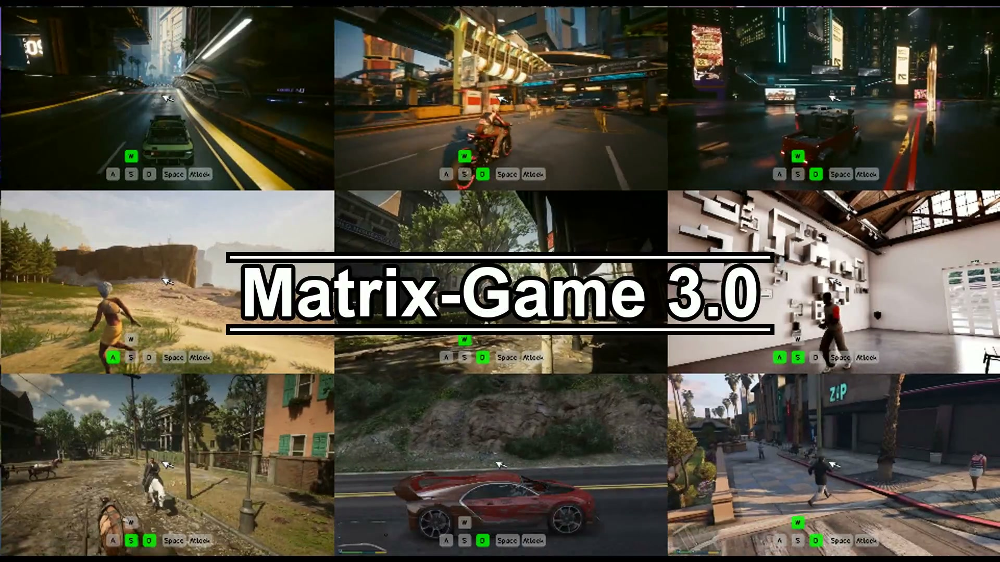

  

# Fei Kang · 康飞

**World Models & Embodied AI · [Skywork AI](https://github.com/SkyworkAI)**  
Former **3D Engine Technical Expert · [Tencent](https://github.com/Tencent)**

[Google Scholar](https://scholar.google.com/citations?user=jJwVbnAAAAAJ&hl=en) &nbsp; / &nbsp; [Research](#selected-research) &nbsp; / &nbsp; [Data Engine](#featured-contribution--world-model-data-engine) &nbsp; / &nbsp; [Media](#media-coverage) &nbsp; / &nbsp; [Engineering](#engineering--open-source)

I am an **Algorithm Researcher at Skywork AI**, focusing on **model architecture, training, and post-training** for **world models and embodied foundation models**, including **World Action Models (WAMs)**.

## Featured Contribution — World-Model Data Engine

**Pioneered the use of Unreal Engine to generate precisely synchronized action–video pairs for interactive world-model training**, designing and building the pipeline introduced in [Matrix-Game 2.0](https://arxiv.org/abs/2508.13009).

## Selected Research

<table>
  <tr>
    <td width="50%" align="center">
      <a href="https://riemann-dynamics.github.io/Riemann-1.0-Website/#real-world">
        
         <strong>Riemann-1.0 · Robot Demos ↗</strong>
      </a>
    </td>
    <td width="50%" align="center">
      <a href="https://matrix-game-v3.github.io/">
        
         <strong>Matrix-Game 3.0 · World Demos ↗</strong>
      </a>
    </td>
  </tr>
</table>

### [Riemann-1.0](https://riemann-dynamics.github.io/Riemann-1.0-Website/) · 2026

**My contribution: owned all model post-training.**

Co-author of an embodied World Action Model unifying **robot policy execution and action-conditioned world simulation**. Reported results: **99.0% LIBERO**, **94.3% RoboTwin 2.0**, and **85.0% real-world manipulation success**.

[Paper](https://arxiv.org/abs/2608.27033) · [Robot Demos](https://riemann-dynamics.github.io/Riemann-1.0-Website/#real-world)

### [Matrix-Game 3.5](https://matrix-game-v3-5.github.io/) · 2026

**My contribution: owned data development; contributed to model architecture design.**

Co-author. Geometry-aware memory and camera conditioning for **persistent interactive worlds**, with long-horizon scene recall and subject consistency.

[Paper](https://arxiv.org/abs/2608.29910) · [Code](https://github.com/Riemann-Dynamics/Matrix-Game-3.5) · [Project](https://matrix-game-v3-5.github.io/)

### [Matrix-3D](https://matrix-3d.github.io/) · 2025

**Omnidirectional, explorable 3D world generation.**

Co-author. Combines trajectory-guided panoramic video generation with **3D reconstruction** to create explorable worlds from text or a single image. Introduces **Matrix-Pano**, a dataset of **116,759 synthetic panoramic video sequences** with camera trajectory annotations.

[Paper](https://arxiv.org/abs/2508.08086) · [Code](https://github.com/SkyworkAI/Matrix-3D) · [Demos](https://matrix-3d.github.io/)

### More Research

- **Matrix-Game 3.0 · 2026** — Co-author; **owned data development and contributed to model architecture design**. Real-time world generation at **up to 720p / 40 FPS**. [Paper](https://arxiv.org/abs/2604.08995) · [Code](https://github.com/SkyworkAI/Matrix-Game/tree/main/Matrix-Game-3) · [Models](https://huggingface.co/Skywork/Matrix-Game-3.0) · [Demos](https://matrix-game-v3.github.io/)
- **Matrix-Game 2.0 · 2025** — Co-author; **designed and built the Unreal Engine data pipeline**. Real-time interactive generation at **25 FPS**. [Paper](https://arxiv.org/abs/2508.13009) · [Code](https://github.com/SkyworkAI/Matrix-Game/tree/main/Matrix-Game-2)
- **Matrix-Game · 2025** — Co-author. **17B** interactive world foundation model for controllable Minecraft generation. [Paper](https://arxiv.org/abs/2506.18701) · [Code](https://github.com/SkyworkAI/Matrix-Game/tree/main/Matrix-Game-1)

Performance figures are reported project results under the evaluation settings in the linked papers.

## Media Coverage

### Riemann-1.0

- [量子位 — 看了20万小时「人类干活实录」，机器人悟了](https://www.qbitai.com/2026/07/454592.html)
- [新浪科技 — 机器人进入世界模型时代，Riemann-1.0如何破解泛化难题？](https://finance.sina.com.cn/tech/it/2026-07-20/doc-iniimuyc2999043.shtml)

### Matrix-Game 3.0

- [量子位 — 国产玩家亮剑世界模型！把全模态卷到顶后，天工AI不藏了](https://www.qbitai.com/2026/03/392835.html)

### Matrix-Game 2.0

- [IT之家 — AI 生成游戏，Matrix-Game 2.0、Matrix-3D 发布并开源](https://www.ithome.com/0/874/688.htm)
- [量子位 — 一周六连发！昆仑万维将多模态AI卷到了新高度](https://www.qbitai.com/2025/08/322418.html)

### Matrix-3D

- [量子位 — 拿下3D生成行业新标杆！昆仑万维Matrix-3D新模型鲨疯了，一张图建模游戏场景](https://www.qbitai.com/2025/08/321401.html)

## Engineering & Open Source

**[Tencent / UnLua](https://github.com/Tencent/UnLua)** — Contributed a merged **C++ fix for Unreal Engine 5 compatibility**, correcting Lua-bound vector, quaternion, and transform math to use engine-compatible scalar types. [Merged PR #339](https://github.com/Tencent/UnLua/pull/339) · [Code](https://github.com/Tencent/UnLua/pull/339/files)

**[PuertsStart](https://github.com/kf953741/PuertsStart)** — Built an **Unreal Engine 5.5 + TypeScript starter** covering GameInstance startup, compilation, and VS Code breakpoint debugging.
