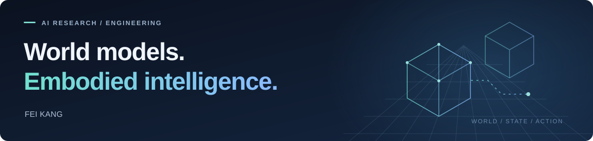

  

# Fei Kang · 康飞

**AI Research & Engineering · [Skywork AI](https://github.com/SkyworkAI)**  
World Models · Embodied Intelligence · World Action Models · Model Post-Training

[Google Scholar](https://scholar.google.com/citations?user=jJwVbnAAAAAJ&hl=en) &nbsp; / &nbsp; [Research](#selected-research) &nbsp; / &nbsp; [Engineering](#engineering--open-source)

I work on **world models, embodied foundation models, and model post-training** at Skywork AI. My work spans interactive world generation, robot learning, and **World Action Models (WAMs)**, supported by a background in 3D engines and simulation.

I am a co-author of **Riemann-1.0, Matrix-3D, and the Matrix-Game series (1.0–3.5)**. Across these projects, I am interested in how models represent the world, predict the consequences of actions, and acquire capabilities for real interaction.

## Areas of Work

- **World models & WAMs** — Interactive generation, visual dynamics, action conditioning, and long-horizon consistency.
- **Embodied AI** — Robotic foundation models and the connection between world simulation and executable policies.
- **Model post-training** — Task adaptation and capability refinement for downstream use.
- **3D engines & simulation** — Unreal Engine, controllable environments, and synthetic data for AI.

## Selected Research

### [Riemann-1.0](https://riemann-dynamics.github.io/Riemann-1.0-Website/) · 2026

**An embodied World Action Model for Physical AI.**

Co-author. A causal autoregressive model that unifies **robot policy execution and action-conditioned world simulation**, learning from heterogeneous embodied experience. Reported success rates include **99.0% on LIBERO**, **94.3% on RoboTwin 2.0**, and **85.0% on evaluated long-horizon real-world manipulation tasks**.

[Paper](https://arxiv.org/abs/2608.27033) · [Project & Robot Demos](https://riemann-dynamics.github.io/Riemann-1.0-Website/)

### [Matrix-Game 3.5](https://matrix-game-v3-5.github.io/) · 2026

**Geometry-aware memory for persistent interactive worlds.**

Co-author. Combines patch memory and camera conditioning with a static–dynamic world representation and progressive distillation for long-horizon scene recall, camera control, and subject consistency.

[Paper](https://arxiv.org/abs/2608.29910) · [Code](https://github.com/Riemann-Dynamics/Matrix-Game-3.5) · [Project](https://matrix-game-v3-5.github.io/)

### [Matrix-Game 3.0](https://matrix-game-v3.github.io/) · 2026

**Real-time streaming generation with long-horizon memory.**

Co-author. The 5B model achieves **up to 40 FPS at 720p**, with memory consistency over minute-long sequences, combining a scalable data engine, camera-aware memory, and few-step autoregressive generation.

[Paper](https://arxiv.org/abs/2604.08995) · [Code](https://github.com/SkyworkAI/Matrix-Game/tree/main/Matrix-Game-3) · [Models](https://huggingface.co/Skywork/Matrix-Game-3.0) · [Project](https://matrix-game-v3.github.io/)

### [Matrix-3D](https://matrix-3d.github.io/) · 2025

**Omnidirectional, explorable 3D world generation.**

Co-author. Connects trajectory-guided panoramic video diffusion with 3D reconstruction to generate explorable worlds from text or an image. Introduces **Matrix-Pano**, a synthetic dataset of **116K panoramic video sequences** with depth and trajectory annotations.

[Paper](https://arxiv.org/abs/2508.08086) · [Code](https://github.com/SkyworkAI/Matrix-3D) · [Project](https://matrix-3d.github.io/)

### Earlier Work

| Project | Research focus | Links |
| :--- | :--- | :--- |
| **Matrix-Game 2.0** · 2025 | Co-author. Few-step autoregressive diffusion for real-time, action-conditioned video generation at **25 FPS**. | [Paper](https://arxiv.org/abs/2508.13009) · [Code](https://github.com/SkyworkAI/Matrix-Game/tree/main/Matrix-Game-2) |
| **Matrix-Game** · 2025 | Co-author. A **17B** interactive world foundation model for controllable Minecraft generation, with the GameWorld Score benchmark. | [Paper](https://arxiv.org/abs/2506.18701) · [Code](https://github.com/SkyworkAI/Matrix-Game/tree/main/Matrix-Game-1) |

Performance figures describe the respective research systems under their reported evaluation settings; see the linked papers for details.

## Engineering & Open Source

### [Tencent / UnLua](https://github.com/Tencent/UnLua)

**C++ contribution to Unreal Engine 5 compatibility.**

Fixed incorrect vector math in the Lua bindings by replacing hard-coded `float` traits with the engine-compatible `unluaReal` type across vector, quaternion, and transform math traits. The fix was merged upstream.

[Merged PR #339](https://github.com/Tencent/UnLua/pull/339) · [Code change](https://github.com/Tencent/UnLua/pull/339/files)

### [PuertsStart](https://github.com/kf953741/PuertsStart)

**A minimal Unreal Engine 5.5 + TypeScript starter.**

A focused Puerts template with TypeScript runtime startup in `GameInstance`, TypeScript-to-JavaScript build configuration, and VS Code breakpoint debugging configuration.

[Repository](https://github.com/kf953741/PuertsStart)

---

**Current focus:** world models · embodied AI · WAMs · model post-training  
**Engineering foundation:** 3D engines · Unreal Engine · C++ · simulation & synthetic data
